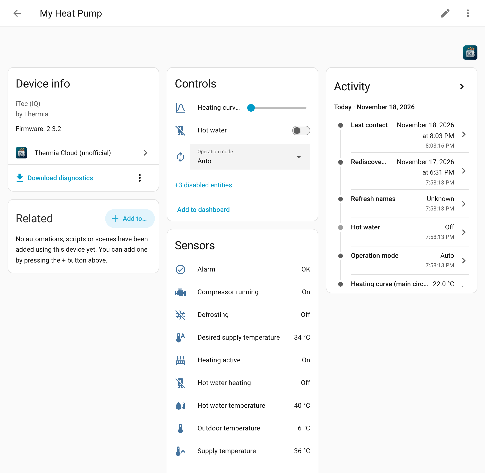
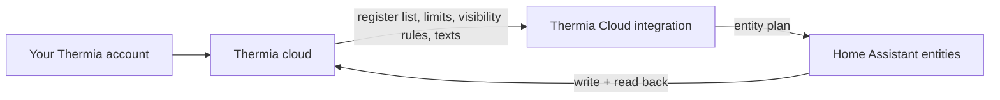

<!-- Status banner: remove when v0.1.0 is released -->
> 🚧 **Status: beta (v0.1.0).** Verified against a real iTec heat pump: reading in production (read-only mode) and reading plus writing in a development Home Assistant. Other model families are expected to work but are unverified. Progress and open work: [`docs/ROADMAP.md`](docs/ROADMAP.md).

<p align="center">
  
  <h1 align="center">Thermia Cloud (unofficial) for Home Assistant</h1>
  <p align="center">
    Read <b>and</b> control your Thermia heat pump through the Thermia cloud —<br>
    all circuits, all registers the cloud exposes, in your language.
  </p>
</p>

<!-- Badges (enable once the repo is public and released)
[](https://github.com/P24L/ha-thermia-cloud/releases)
[](https://github.com/P24L/ha-thermia-cloud/actions/workflows/validate.yml)
[](https://github.com/P24L/ha-thermia-cloud/actions/workflows/tests.yml)
[](LICENSE)
-->

> **Unofficial.** Not affiliated with, endorsed by, or supported by Thermia or Danfoss. It uses the same cloud service as the Thermia web app and may stop working if Thermia changes it.

## Why another Thermia integration?

The existing [Thermia integration by klejejs](https://github.com/klejejs/ha-thermia-heat-pump-integration) is the reason many of us have our heat pumps in Home Assistant at all — thank you. This project takes a different route for the long term:

| | Existing integration | **Thermia Cloud** |
|---|---|---|
| Which entities exist | Hard-coded per register in Python | **Discovered from the cloud's own description** of your heat pump; unknown registers still show up |
| Changing settings | Hot water and operation mode | **Any writable register** the cloud allows (heating curve, min/max supply temperature, heating stop, …) with the cloud's own limits |
| Several heating circuits | Main values only | Main circuit **and** circuits 1/2, pool, … as child devices |
| Names | English | Our own short names in **English and Czech**; in the other languages Thermia's own texts (16 languages, e.g. *Přívod – minimum*) |
| Hidden / unsupported registers | Silently unavailable | Hidden by Thermia's own visibility rules; vanished registers explained by a Repair |
| Cloud traffic | ~9 requests every 10 s | Only the groups you use, every 60 s by default |
| Safety | — | Optional **read-only mode**, installer-level registers opt-in, every write validated and read back |
| Several heat pumps | ✔ | ✔ |

## Features

- ✅ Sensors, binary sensors (compressor, heating, hot water, defrost, …), numbers, selects and switches generated from your pump's register list
- ✅ **Control, not just monitoring:** hot water on/off and mode, operation mode, heating curve — plus minimum/maximum supply temperature, heating stop and any other writable register, all with the cloud's own limits
- ✅ Main circuit and additional circuits/pool as separate devices
- ✅ UI in English and Czech; entity names in the language of your choice (default: your HA language): our own names where we have them, Thermia's own texts otherwise, with a **Refresh names** button
- ✅ Action `thermia_cloud.set_register` for registers without an entity
- ✅ Options in the HA UI: update interval, read-only mode, request timeout, installations, show/hide registers, label language, debug attributes
- ✅ Reauth and reconfigure flows, Repairs, downloadable diagnostics
- ✅ Multiple installations per account

<!-- Screenshots: put images in docs/img and enable
<p align="center">
   
</p>
-->

## Requirements

- Home Assistant **2026.10** or newer (2026.11+ recommended: built-in Marketplace)
- A Thermia heat pump connected to **Thermia Online / MyThermia** (the cloud account you use in the Thermia app)
- Tested family: **iTec**. Other families (Genesis, Atlas, Diplomat, ATEC, …) should show their registers automatically, but we need your help to polish them — see [Supported models](#supported-models).

## Installation

### Home Assistant 2026.11+ (Marketplace)

1. *Settings → Marketplace → ⋮ → **Add from link***
2. Enter `P24L/ha-thermia-cloud` → **Download**
3. The setup dialog usually opens right away (if Home Assistant asks for a restart, do it)

[](https://my.home-assistant.io/redirect/hacs_repository/?owner=P24L&repository=ha-thermia-cloud&category=integration)

### Home Assistant 2026.10 (HACS)

Add `https://github.com/P24L/ha-thermia-cloud` as a custom repository (category *Integration*) in HACS, download, restart Home Assistant.

### Manual

Copy `custom_components/thermia_cloud` into your `config/custom_components/` folder and restart.

## Setup

1. *Settings → Devices & services → Add integration → **Thermia Cloud***
2. Sign in with your Thermia e-mail and password
3. Pick your installation(s) if the account has more than one
4. Done — your heat pump appears as a device with its everyday sensors **and controls** enabled; installer-level and unknown registers are available but **disabled** (enable them in *Settings → Devices → Entities*)

> 💡 Want monitoring only? Turn on **Read-only mode** (*Configure → General*) — the integration then cannot change anything on your heat pump.

## Entities at a glance

| Group (examples) | Platform | Enabled by default |
|---|---|---|
| Outdoor, supply line, desired supply line, hot water temperature | `sensor` | ✔ |
| Compressor, heating, hot water, defrost (status flags Thermia marks as visible) | `binary_sensor` | ✔ |
| Compressor / heating / hot-water / aux-heater hours | `sensor` (diagnostic) | ✔ |
| Heating curve (main circuit on the heat pump device, mixing circuit 1/2 as child devices) | `number` | ✔ |
| Supply min/max, heating stop, circuit mode (installer-level) | `number` / `select` | ✘ (enable when needed) |
| Hot water on/off, hot water mode, operation mode | `switch` / `select` | ✔ |
| Anything else the cloud exposes | generic | ✘ |

The exact set depends on your heat pump — Thermia's cloud tells the integration what exists and which registers are visible.

## Changing settings safely

Controlling the heat pump is a core feature: switch hot water, change the operation mode, tune the heating curve. Because heating settings decide how a building is heated (a wrong value in the wrong season can freeze a house), a few guard rails are built in:

- Everyday controls are on. **Installer-level registers** (min/max supply temperature, heating stop, circuit mode, …) and **registers we don't know yet** are created *disabled* until you enable them in the entity list — they are set-and-forget values and would otherwise add dozens of entities.
- Values are checked against the limits the cloud reports and **read back** after writing; a mismatch is reported, never hidden.
- Optional **Read-only mode** blocks every write.
- The Thermia cloud **queues** writes: if the pump is offline, the change is applied when it reconnects.

## Configuration (⚙ *Configure*)

| Option | Default | Description |
|---|---|---|
| Update interval | 60 s | 10–600 s |
| Read-only mode | off | Block all writes (monitoring only) |
| Installations | all | Which installations of the account to use |
| Show registers hidden by Thermia | off | Ignore Thermia's visibility rules |
| Expose unknown registers | on (disabled entities) | Generic entities for registers we have no entry for |
| Label language | Auto (HA language) | Language of the register names; English fallback |

Buttons on the device page: **Refresh names** (pull the latest label texts from Thermia) and **Rediscover registers**.

## Actions

`thermia_cloud.set_register` writes any register by name, including ones that have no entity. Fields: `device_id` (the heat pump device), `group` (e.g. `REG_GROUP_HEATING_CURVE`), `register` (name or index) and `value`. It follows the same rules as the entities: Read-only mode blocks it, installer-level registers are refused, and the value is validated against the limits the cloud reports. It returns when the cloud has accepted the value (it does not wait for the read-back).

## How data is updated

The integration polls the Thermia cloud every 60 seconds (configurable, 10–600 s) and only reads the register groups that contain an enabled entity — typically about seven requests per minute. After a write it polls every 5 seconds for up to 30 seconds until the value shows up. The register list is cached and refreshed daily. Thermia does not offer push notifications.

## Known limitations

- Unofficial API: Thermia may change it without notice.
- The cloud answers writes with "accepted" even when the pump is offline; the change is applied when the pump reconnects, so the displayed value can lag (`pending_value` attribute).
- Registers can disappear from the cloud's answer; their entities stay `unavailable` (and after 7 days a Repair explains it).
- Only the iTec family has been checked so far.

## Removing the integration

*Settings → Devices & services → Thermia Cloud → ⋮ → Delete*. Nothing is left on the heat pump; the integration stores only its own cache files inside Home Assistant.

## Dashboard example (Mushroom)

Entity ids are derived from the names in your language when the entity is first created (a Czech setup gets Czech ids), so copy your own from *Settings → Entities*:

```yaml
type: vertical-stack
cards:
  - type: custom:mushroom-title-card
    title: Heating
  - type: custom:mushroom-number-card
    entity: number.<your_heating_curve_entity>
    display_mode: slider
    icon: mdi:chart-bell-curve
```

## Supported models

| Family | Status | Notes |
|---|---|---|
| iTec | ✅ read-only operation verified on the author's pump; ⏳ writing not yet verified | 26 registers visible on profile 1005; 28 entities, 11 enabled by default |
| Genesis, Atlas, Diplomat, ATEC, Mega, … | ❓ expected to work, unpolished | Registers are discovered automatically; help us with a fixture |

**Help us support your model:** install the integration, *Download diagnostics*, open a *New model* issue. Diagnostics are redacted; we turn them into test fixtures and catalog entries.

## How it works



1. Signs in like the Thermia web app does and discovers your installations.
2. Reads the register groups of your heat pump and Thermia's visibility rules.
3. Builds entities from that description plus a small curated [catalog](docs/CATALOG.md) (units, defaults, safety flags).
4. Polls only what you use; writes are validated and verified.

Deep dive: [Architecture](docs/ARCHITECTURE.md) · [API notes](docs/API-NOTES.md) · [UI design](docs/UI-DESIGN.md)

## Troubleshooting

<details><summary>Sign-in fails with a valid password</summary>

Thermia sometimes requires you to accept updated terms. Open <https://online.thermia.se>, sign in once, accept, then retry. The integration raises a Repair when it detects this.
</details>

<details><summary>An entity is <code>unavailable</code> and says "not provided by cloud"</summary>

Thermia stopped returning that register for your installation (this happened to some values after the 2026 portal migration). The integration cannot bring it back; remove the entity from the Repair dialog if it does not return.
</details>

<details><summary>I enabled a number entity but changing it does nothing</summary>

Check *Configure → General → Read-only mode*. Writes are also refused for registers that the cloud reports as read-only.
</details>

<details><summary>Names are in English although my HA is Czech</summary>

Some Thermia labels exist only in English. Check *Configure → Names & language* (Auto follows your HA language), press **Refresh names** on the device page, or rename the entity in HA (your name is kept).
</details>

<details><summary>How do I report a problem?</summary>

Open an issue with *Download diagnostics* attached (*Settings → Devices & services → Thermia Cloud → ⋮ → Download diagnostics*). Never post your password or tokens.
</details>

## Related projects

Different approach, different strengths — pick what fits your heat pump:

- [`klejejs/ha-thermia-heat-pump-integration`](https://github.com/klejejs/ha-thermia-heat-pump-integration) — the original cloud integration (this project's predecessor)
- [`CJNE/thermiagenesis`](https://github.com/CJNE/thermiagenesis) — **local Modbus** for Genesis / Inverter / Mega
- [`ryckema/Thermia_itec`](https://github.com/ryckema/Thermia_itec), [`mdepa91/esphome-thermia`](https://github.com/mdepa91/esphome-thermia) — **local** iTec access via ESPHome
- [`ThermIQ/thermiq_mqtt-ha`](https://github.com/ThermIQ/thermiq_mqtt-ha) — ThermIQ-MQTT

## Contributing

Fixtures, catalog entries, translations and bug reports are the most valuable contributions. See the [roadmap](docs/ROADMAP.md) for open work and [`docs/DEVELOPMENT.md`](docs/DEVELOPMENT.md) for the development setup and test instructions. See also [`CONTRIBUTING.md`](CONTRIBUTING.md).

## Credits and license

Built on the work of **klejejs** (`python-thermia-online-api`, `ha-thermia-heat-pump-integration`, both GPL-3.0) — see [`NOTICE.md`](NOTICE.md). Licensed under **GPL-3.0-or-later** ([`LICENSE`](LICENSE)).
