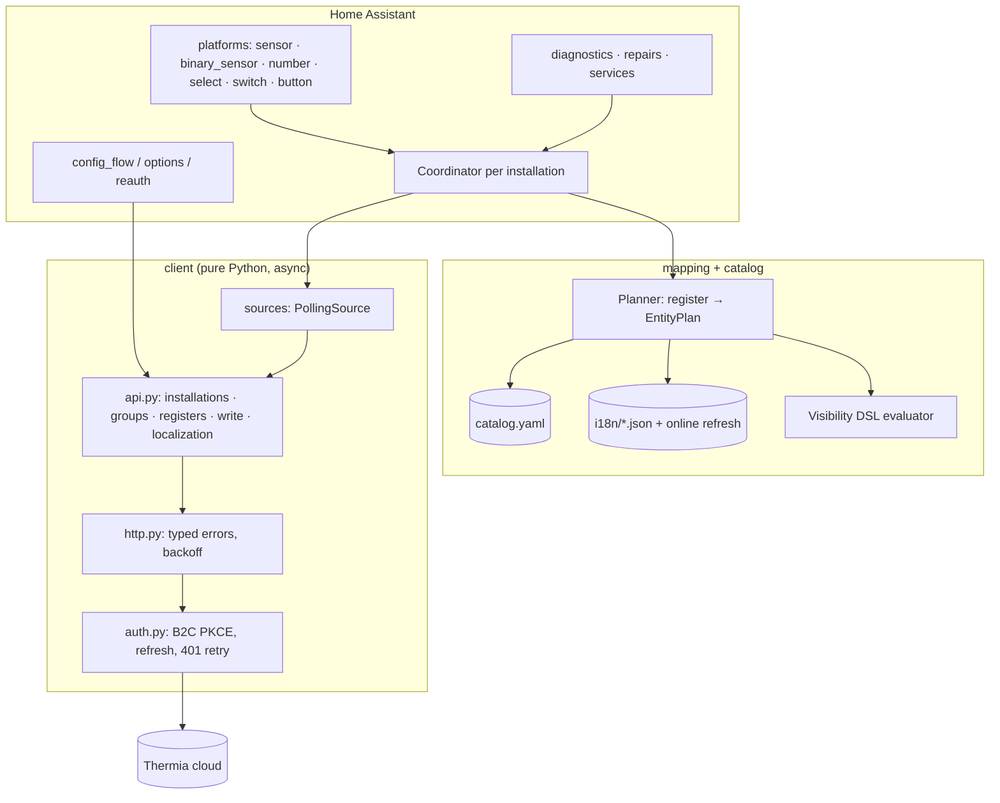

# Architecture

Goal: an integration that **describes itself from the cloud** instead of hard-coding heat-pump models, works with several circuits and several installations, and lets the user adjust what is exposed — all from the HA UI.

See also: `API-NOTES.md` (facts about the cloud), `CATALOG.md` (curated data), `UI-DESIGN.md` (screens), `DECISIONS.md`.

## 1. Principles

1. **The cloud describes, the catalog interprets.** Limits, writability, enum values and visibility come from the cloud; names, units, device classes, defaults and safety flags come from a small catalog. No per-model code.
2. **Unknown must still work.** A register the catalog has never seen becomes a generic, *disabled-by-default* entity.
3. **Never fail silently.** Typed errors, no "empty list means problem" ambiguity, no swallowed 401.
4. **Pure client, thin glue.** `client/` has no Home Assistant imports and is testable alone.
5. **Cheap polling.** Fetch static metadata once; poll only values, only for groups someone uses.
6. **Safe writes.** Validate, rate-limit, read back, support read-only mode.

## 2. Layers

### 2.1 `client/` (no `homeassistant` imports)

| Module | Responsibility |
|---|---|
| `errors.py` | `ThermiaError` ▸ `AuthError` (**definitive** bad credentials only) · `LoginFlowError` (HTML/csrf changed, captcha, B2C 5xx) · `PolicyAcceptanceError` · `NetworkError` · `ApiError(status)` · `RateLimitError(retry_after)` · `RegisterWriteError` |
| `config.py` | Reads `/api/configuration` (apiBaseUrl, authority, clientId, scopes, `isWebSocketEnabled`), caches it |
| `auth.py` | Async B2C PKCE flow, **written independently** from the protocol description in `API-NOTES.md` §2 (no upstream code copied). Own `ClientSession` with a private cookie jar (never HA's shared session), token store, **proactive refresh** at `expires_on` − margin, single-flight lock with a token-generation counter (7 concurrent 401s → one login), honest `User-Agent` (`HomeAssistant thermia_cloud/<version>`) |
| `http.py` | One `request()` used by everything: timeouts, `401 → re-auth once (generation-checked) → retry once`, bounded immediate retries with jitter inside one request; longer waits are the coordinator's job (no stacked backoffs); redacted logging |
| `models.py` | Dataclasses: `Installation`, `Group`, `RegisterSpec` (immutable: ids, name, limits, presentation, valueNames, modifier, visibility condition), `RegisterValue` (value, timestamp), `Snapshot` |
| `api.py` | `list_installations()`, `get_installation()`, `get_groups(profile)`, `get_group_registers(inst, group)`, `get_history_registers(inst)`, `write_register(inst, spec, value)`, `get_languages()`, `get_localization(culture)`, `get_status(inst)` |
| `sources.py` | `ValueSource` protocol + `PollingSource` (default). A WebSocket source is **deferred** (P10.7): the flag is off and `/ws` answers 404 today |
| `visibility.py` | Tokenizer/parser/evaluator for the condition language (`{REG_X} >= 1 AND …`). Unknown reference → `True` + recorded |

### 2.2 `catalog/` and mapping

- `catalog.yaml` + loader + schema (see `CATALOG.md`).
- `i18n/<culture>.json` bundled snapshots; `LabelResolver` merges *bundled → stored-refresh → humanized key* using the HA language (`cs` → `cs-CZ`, same-language fallback, then `en-US`).
- `planner.py` turns `(RegisterSpec, current values, catalog, options)` into an immutable `EntityPlan` (platform, key, name, unit, device_class, state_class, entity_category, default_enabled, device bucket, writable limits). **Pure function → table-driven tests against the fixtures.**

### 2.3 HA glue

| File | Responsibility |
|---|---|
| `config_flow.py` | user → create (installation selection lives in **options**); `reauth`; `reconfigure`; options flow. Entry `unique_id` = token `sub` (§6) |
| `coordinator.py` | one `DataUpdateCoordinator` per installation, `config_entry` passed explicitly, `always_update=False` with a comparable snapshot dataclass; raises `ConfigEntryAuthFailed` / `UpdateFailed(retry_after=…)` |
| `entity.py` | base entity (`has_entity_name=True`, device info, availability, `register_timestamp` attribute) |
| `sensor.py` `binary_sensor.py` `number.py` `select.py` `switch.py` `button.py` | thin: instantiate from `EntityPlan`s |
| `diagnostics.py` | redacted dump: installation meta, group/register specs, plan, visibility results, errors |
| `repairs.py` | issues: policy acceptance required (not fixable in HA), register vanished, discovery empty |
| `services.yaml` | `thermia_cloud.set_register` (power users): registered in `async_setup`; targets a config entry/device; same risk and read-only policy as entities (see UI-DESIGN §5) |
| `runtime_data` | `ConfigEntry.runtime_data = ThermiaRuntime(client, coordinators, catalog, labels)` (no `hass.data`) |

## 3. Data flow

### 3.1 Discovery (cached)

1. `client.config` → endpoints. `client.auth` → token (stored refresh token first if P0.1 allows it, full login otherwise).
2. `list_installations()` → one **device** per *selected* installation (selection is an option, §6).
3. Per installation: `get_installation()` → `installationProfileId` → `get_groups(profile)` → `get_group_registers()` for every group. Empty groups are remembered, not re-polled.
4. `get_history_registers()` → visibility conditions and `disabledRegisterValue`, keyed by `registerIndex` (this response calls it `registerId`). Only some registers have history metadata (14 of 26 in the iTec fixture); the others have no `disabledRegisterValue`.
5. **Discovery cache:** specs, history metadata, empty-group list and a timestamp are persisted in a HA `Store`. Setup uses the cache when the cloud is unreachable (instead of `ConfigEntryNotReady` forever). Rediscovery runs daily, on the *Rediscover* button, and when a cached register disappears from a polling response. Entry reloads (enabling an entity, options save, label refresh) therefore do **not** repeat the 23-group discovery.
6. Labels for the chosen language (bundled snapshot, refreshed copy from `.storage` if the user pressed *Refresh names*).
7. **Planner** builds immutable `EntityPlan`s:
   - **Visibility is split in two.**
     - *Structural* conditions reference **other** registers (`{REG_ACTIVATE_POOL} = 1`, `{REG_SER_AUX_HEAT_MAX_STEP} >= 1`). They are evaluated at discovery; if false the entity is not created (unless *Show hidden registers* is on).
     - *Value-based* conditions reference the register **itself** (`{REG_HOT_WATER_TEMPERATURE} > 0`) and `disabledRegisterValue` (`-100` = sensor not connected). They are evaluated **on every poll** and make the entity `unavailable`. A transient 0 at setup therefore never removes an entity.
     - Unresolved reference → treated as visible and listed in diagnostics. References are by *name*; when a name exists in several groups resolve inside the same group first, else flag it.
   - Catalog entry (`GROUP/NAME`, then `NAME`) or the generic rules (§4); names per §4.3.
   - `default_enabled` from the catalog (generic → `False`); read-only registers (sensors, status flags) whose `timeStamp` is older than 30 days (e.g. a disconnected indoor sensor last updated in 2024) are created disabled with a `stale` attribute. Settings (number/select/switch) are exempt: their timestamp is the last *change*, which can legitimately be years old (hot-water mode, 2024).
8. Platforms add entities; the entity registry remembers user choices (enabled, renamed, area).

### 3.2 Polling

- **Needed groups** = groups with at least one *enabled* entity (read from the entity registry at setup) **plus** groups referenced by runtime visibility conditions. HA itself reloads the entry shortly after a user *enables* an entity, which refreshes the set; *disabling* does not reload, so we over-poll until the next reload. (Verified in P4.5 by a test: enabling an entity makes HA reload the entry about 30 s later; we do not build our own reload.)
- Default interval **60 s** (10–600 s), groups fetched concurrently. The default-enabled set touches about **7 groups → ~7 requests/min per installation**, versus ~54/min (9 requests every 10 s) in the upstream integration.
- One `DataUpdateCoordinator` per installation with an explicit `config_entry` and `always_update=False`; the snapshot is a comparable dataclass, so entities only write state when something changed (no custom change detection). `timeStamp` is exposed as an attribute.
- **Errors/backoff:** the HTTP layer only retries immediately within one update. Longer waits belong to the coordinator: `UpdateFailed(retry_after=…)` for 429/5xx. `CoordinatorEntity` entities become `unavailable` on the **first** failed update; we log exactly one line when the cloud goes down and one when it recovers.
- **Fast poll after a write:** the interval shortens to 5 s for up to 30 s.
- **Push:** not in v0.x (P10.7). The `ValueSource` seam remains.

### 3.3 Writing

`entity.async_set_native_value()` / `async_select_option()` / switch → `client.write_register()`:

1. Reject with `HomeAssistantError` (translated) if **read-only mode** is on or `spec.isReadOnly`.
2. **Validate:** numbers against `min/max/step` (error, never a silent clamp); enumerations against the **visible `valueNames`** — *not* against `min/max`, which can be `null` (operation mode) or wrong (hot-water mode: `max=1` but the visible value `Away` is 2).
3. **Serialize writes per installation** with an asyncio lock. There is **no debounce**: HA calls the action on release, and an action must report its own errors to the caller.
4. `POST …/Registers`; non-200 → `RegisterWriteError` → `HomeAssistantError`.
5. After the POST succeeds the action returns. A background task fast-polls until the read-back matches; meanwhile the entity **shows the written value** (optimistic, so a changed setting does not snap back) with the attribute `pending_value` marking it as unconfirmed; it falls back to the real value if the read-back does not arrive within 30 s. On timeout: if the installation is online, log one warning and keep showing the real value; if it is offline (`isOnline` false), log at info level — the cloud **queues** the write and applies it later. No exception after the action has returned.

## 4. Generic mapping rules (used when the catalog has no entry)

| Cloud says | Entity | Defaults |
|---|---|---|
| read-only, `Integer` or `Slider`, no `valueNames` | `sensor` | disabled; unit per §5; `state_class` only when known (temperature → `measurement`, hours → `total_increasing`), unknown → none; `suggested_display_precision` from `step` |
| `isComputedRegister` | read-only `sensor` | disabled |
| writable `Slider`, min/max/step | `number` (`slider` if ≤ 100 steps, else `box`) | **disabled** (unknown semantics — the catalog decides what is enabled by default) |
| writable `Integer` with min/max | `number` (`box`) | disabled |
| writable `Integer` without limits | skipped; diagnostics note (nothing safe to validate against) | — |
| `Enumeration`, writable, visible values exactly `{0, 1}` | `switch` | disabled |
| `Enumeration`, writable, anything else | `select` (options and validation = visible `valueNames`) | disabled |
| `Enumeration`, read-only | `sensor` (`device_class=enum`) | disabled |
| `StatusFlags*` / bitmask | one `binary_sensor` per **visible** value name; `unique_id` suffix = flag value | disabled; catalog can enable |
| `PosixTime` | `sensor` (`device_class=timestamp`) | disabled |
| `SliderFormattedTime` and other unknown presentations | skipped; diagnostics note until a fixture exists | — |
| `Hidden` / `isInvisible` | none | — |
| value == `disabledRegisterValue` | state `unavailable` | — |

### 4.1 State rules

- **Enumerations:** the current value maps to the **visible** value name with that value (*visible wins*). Example from the fixture: hot-water mode value `0` matches hidden `REG_VALUE_STATUS_OFF` **and** visible `Comfort`. If only hidden names match, the state is unknown (`None`) and an attribute shows the raw value.
- **Status flags:** only visible flags get entities. Hidden bits (e.g. radiator pump, bit 2, set in the fixture value 19) get none; set bits that have no name at all are listed in a diagnostic attribute. Decoding of `StatusFlagsTextInd` (bitmask vs priority text) is unverified (P0.7); the working rule is: `StatusFlags` → equality, everything else → `value & flag == flag`.

### 4.2 Overrides

Per-register overrides (`options.overrides`, see `CATALOG.md` §4) are an **optional, later feature** (the editor is **not** in v0.1, P10.8; `UI-DESIGN.md` §4). The planner supports a merge step for them, but nothing in v0.1 depends on it.

### 4.3 Names and collisions

Thermia's labels carry no context: on one device the Czech labels alone would give "Teplá voda" four times (status, hours, flag, temperature), "Kompresor" and "Ohřev" twice (hours + flag), "Provozní režim" twice.

- **Curated registers** get a catalog `translation_key` and names from our own `translations/<lang>.json` (short, unambiguous). Thermia's labels are used only for registers the catalog does not curate.
- **Collision pass** in the planner: if two entities on the same device resolve to the same name, append the group/kind label ("Hot water (hours)").
- **Brackets** in a label are stripped only when their content parses as a known unit (`[°C]`), never blindly (`(systém)` is part of the name).
- Entity ids are derived from the localized name at first creation, so a Czech installation gets Czech entity ids; documentation tells users to copy their own.

## 5. Unit / device-class resolution

Order: **catalog override → modifier map (8, 12, 1 → °C; 16 → h) → unit parsed from the English (`en-US`) label through a fixed unit table → none.** Never parse units out of localized labels (`(Dní)`). The modifier alone is not trusted (`REG_HEATING_HEAT_STOP` is °C with modifier 0; `REG_SER_HOT_WATER_TOPH_INTER` is days with modifier 0). Unknown unit ⇒ no `device_class`, no statistics.

## 6. Devices, circuits, identity

- **Installation device**: identifiers `(thermia_cloud, installation_id)`, name = installation name (e.g. *My Heat Pump*), manufacturer *Thermia*, model, `sw_version` = firmware.
- **Child devices** via `via_device` for physical parts (`…_CIRC1`, `…_CIRC2`, `POOL`, `COOLING`, `BUFFER_TANK`). The catalog maps a **group** to a device and may override it **per register** (e.g. `REG_OPER_DATA_DISTR_CIR1` lives in `TEMPERATURES` but belongs to circuit 1). **Default device = `main`** for unmapped groups. Child device names come from `DeviceInfo(translation_key=…)` in our translations.
- **Config entry identity:** `unique_id` = the token's `sub` (or `oid`) claim; fallback lower-cased e-mail only if no claim exists. Reauth and reconfigure call `_abort_if_unique_id_mismatch`, so changing the e-mail in *Reconfigure* keeps the entry.
- **Installations:** the selection lives in the entry **options**. An installation that appears later gets its device on the next rediscovery; stale devices can be removed by the user (`async_remove_config_entry_device`).
- **Several accounts:** several entries, nothing shared except the catalog.
- **Unique ids of entities:** see `DECISIONS.md` D10.

## 7. Errors and repairs

| Situation | Behaviour |
|---|---|
| Wrong password in the setup form | form error `invalid_auth` |
| **Definitive** wrong credentials during runtime | `ConfigEntryAuthFailed` → HA's **reauth** flow (this is the user-facing surface; no extra Repair) |
| Login flow broken (HTML/`SETTINGS` changed, csrf missing, captcha, B2C 5xx) | `LoginFlowError` → `UpdateFailed` (retry later), one warning. **Never reauth** — a password prompt cannot fix it |
| Login blocked by an updated-terms page | `PolicyAcceptanceError` → non-fixable Repair *"Accept Thermia's updated terms at online.thermia.se"* + `UpdateFailed`; the Repair clears itself when login works |
| Cloud/network down, 429, 5xx | `UpdateFailed(retry_after=…)`; one log line down, one up |
| A known register is no longer returned | entity `unavailable` with `reason: not_provided_by_cloud`; Repair after 7 days offers removal (exactly what happened to `REG_PID`) |
| Discovery returns zero registers | Repair + diagnostics hint (cloud-side restriction) |

Tokens die after 1–2.5 h, so a scraped login happens every hour or two unattended: transient failures must never look like bad credentials.

## 8. Security and privacy

- Credentials in the config entry (HA standard). Whether a refresh token can replace the stored password is decided by spike P0.1.
- Never log tokens/passwords; query strings redacted.
- **Diagnostics redact:** e-mail, password, access/refresh tokens, JWT claims, installation id, `deviceId`, MAC, `location`/address, `lastOnline`, `clientUuid`, `queueId`, serials. The installation name is **dropped**, not hashed (a low-entropy value is dictionary-reversible). A test asserts that no key from a denylist survives.
- Fixtures: the current ones were extracted and hand-checked (no e-mail, MAC, address, installation id/name); future ones only via `scripts/anonymize.py`.

## 9. Testing seams

- `client` takes an `aiohttp.ClientSession` → mock with recorded fixtures (including anonymized auth HTML/JSON, installations, status and write responses — P2.12).
- `planner` is a pure function → snapshot tests per fixture profile.
- Coordinator/platform tests use `pytest-homeassistant-custom-component` with a fake client.
- `scripts/live_smoke.py` (read-only) validates the real cloud before releases.

## 10. Non-goals / later

PyPI extraction of `client/`; HA core submission; WebSocket push (P10.7); per-register override editor (P10.8); history/statistics import from the DataHistory endpoint; composite `water_heater`/`climate` entities (generic entities come first); other profile families (need community dumps).
